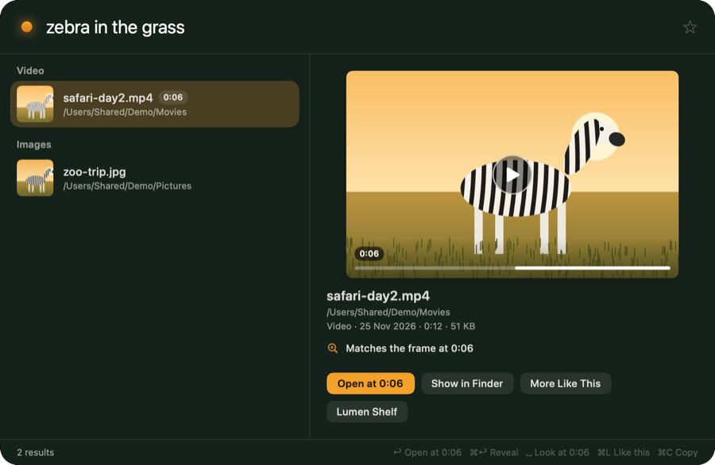
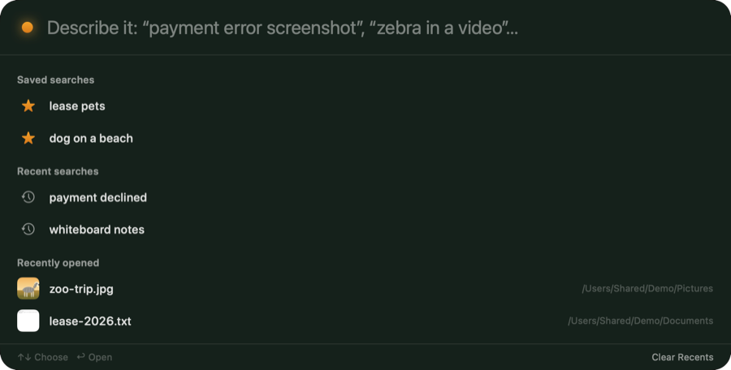
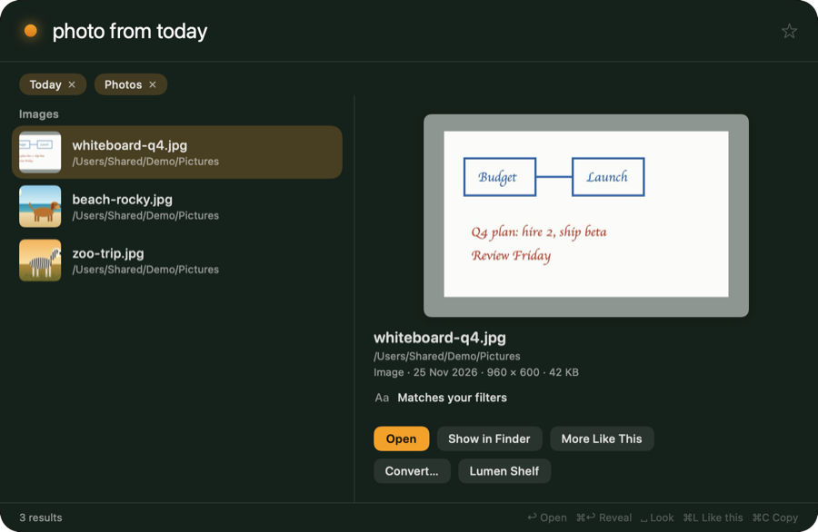
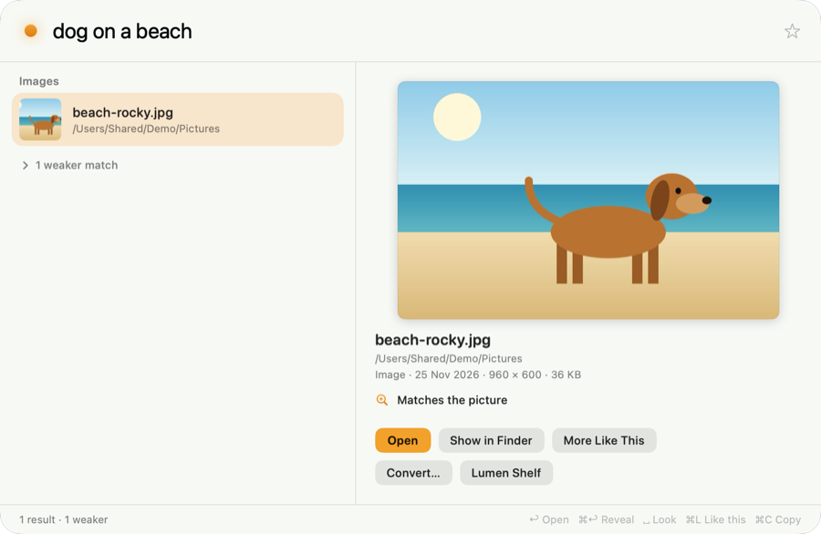
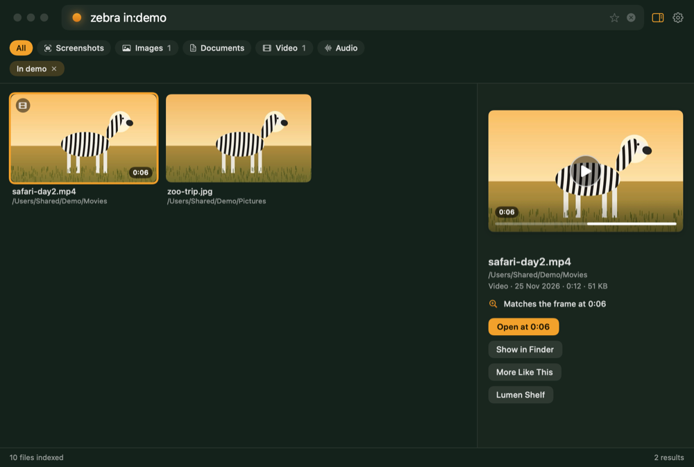

  

<h3 align="center">Describe it. Unearth it.</h3>

  Find the photos, PDFs, videos and recordings on your Mac by what's in them, 
  even when you don't remember what they're called.

  

  
  &nbsp;Free · Notarized by Apple

  

## Download

| You need | |
|---|---|
| Mac with Apple Silicon (M1 or newer), macOS 14 or later | **[Download Unearth](https://github.com/SamayW/unearth-releases/releases/latest/download/Unearth.dmg)**, always the latest |
| About 1 GB free | For the search model, downloaded once (865 MB) |

### Install

1. Open **Unearth.dmg** and drag **Unearth** into **Applications**.
2. Open Unearth. If macOS asks, click **Open**.
3. Choose the folders to search. macOS asks before Unearth can read Desktop, Documents or Downloads: click **Allow**.
4. Leave it running while it downloads its model and reads your files the first time. A big folder can take an hour.

## How to use it

Press **⇧⌘Space** in any app and describe what you're looking for.

| Type | To find |
|---|---|
| `a dog on the beach` | the photo |
| `zebra in a video` | the video, at that moment |
| `the clause about pets in the lease` | the page of the PDF |
| `payment declined error` | the screenshot |
| `pdf from last week` | every PDF since last week |
| `whiteboard in:Pictures` | only what's in Pictures |

| Press | To |
|---|---|
| ⇧⌘Space | Open Unearth from anywhere (you can change it in Settings) |
| ↑ ↓ | Move through the results |
| Return | Open the result, at its page or moment when the app allows it |
| Space | Preview it (after moving to a result) |
| ⌘L | More like this |
| ⌘S | Save the search |
| ⌘C | Copy the file |
| ⌘Return | Show it in Finder |
| ⌘O | Open the bigger window |

Unearth lives in the menu bar, where you can pause it, open Settings or quit.

## What's inside

<table>
  <tr>
    <td width="50%" valign="top">
      
      
<b>Ready before you type.</b> Saved searches, recent ones, and files you opened.

    </td>
    <td width="50%" valign="top">
      
      
<b>Filters in plain words.</b> Dates, file types and folders become chips you can remove.

    </td>
  </tr>
  <tr>
    <td width="50%" valign="top">
      
      
<b>Convert and More Like This.</b> Save a picture as PNG, JPEG, HEIC, AVIF, TIFF, GIF, BMP or PDF. The original isn't changed.

    </td>
    <td width="50%" valign="top">
      
      
<b>A bigger look.</b> A grid of pictures with filters by kind.

    </td>
  </tr>
</table>

**Works with [Lumen](https://github.com/SamayW/lumen-releases).** If you have it, **Lumen Shelf** puts a copy of any result on your notch shelf.

## Your data

- **Everything you index stays on your Mac.** No account, no tracking.
- **Unearth goes online once,** to download its model.
- **It only reads the folders you choose,** and doesn't change your files. Converting a picture saves a new copy beside it.

## Updates

Unearth doesn't update itself yet. Download the newest version here and replace the old one in Applications. Your index and settings stay.

## Uninstall

Quit Unearth from the menu bar, then delete it from Applications. To remove its model and index too, delete `~/Library/Application Support/Unearth`.

## Report a problem

Open an [issue](https://github.com/SamayW/unearth-releases/issues) with your macOS version, your Mac model and what happened.

---

Made by <b>Samay Wadhwani</b> · <a href="https://github.com/SamayW/unearth-releases/releases">All releases</a> · <a href="LICENSE">License</a>

